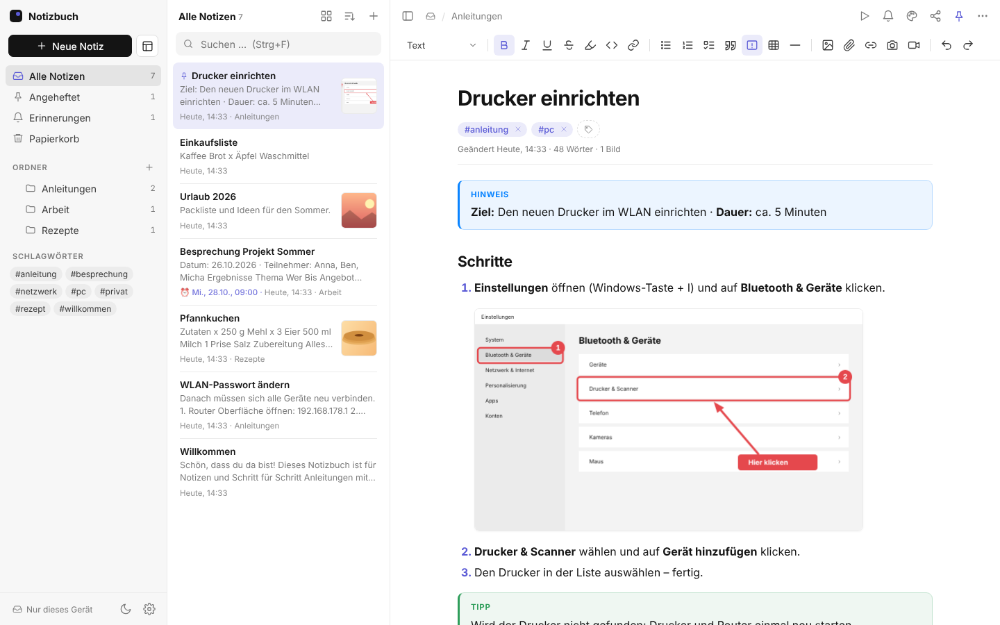
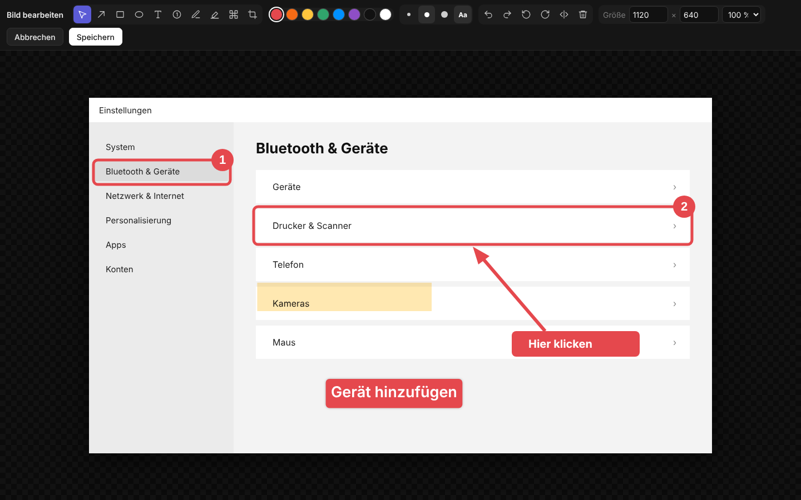
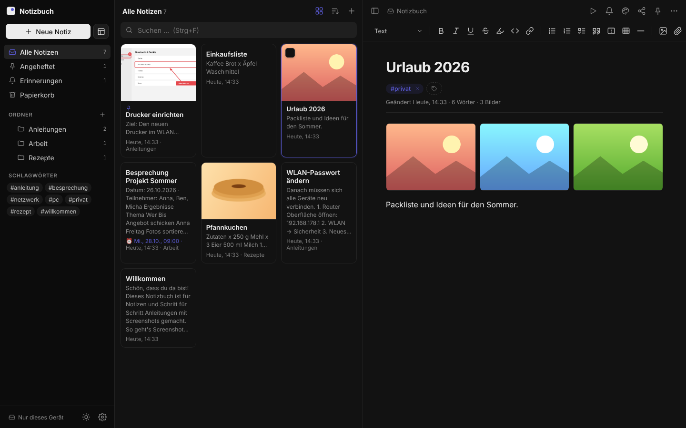
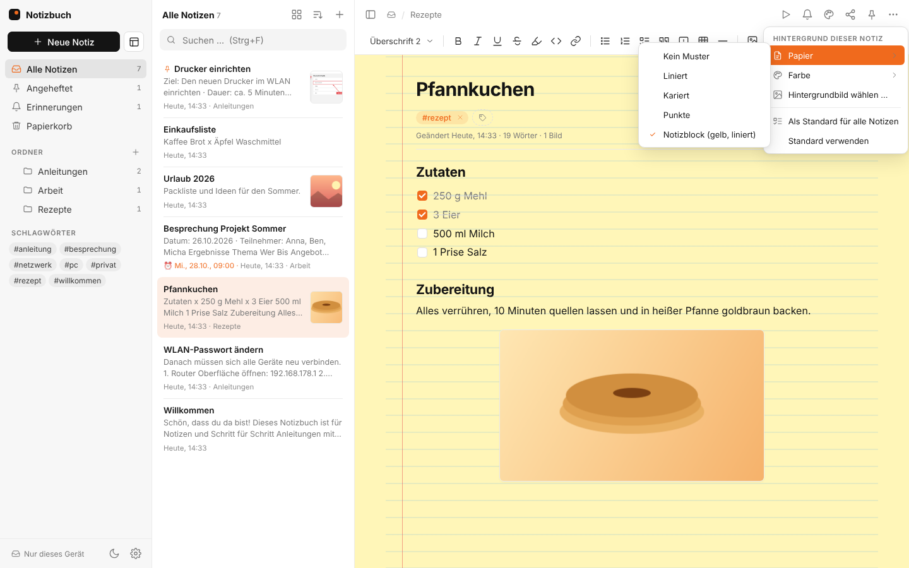
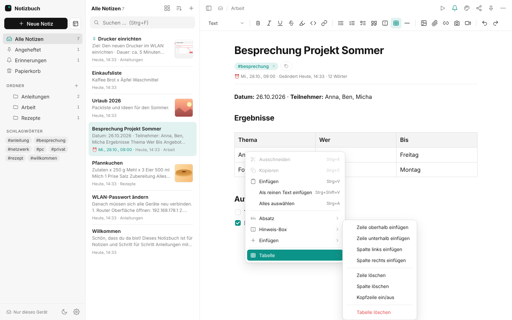
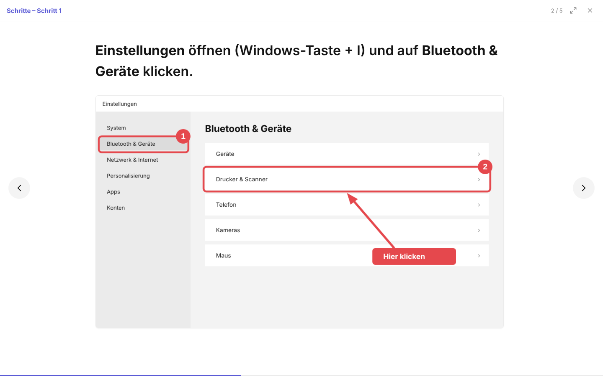
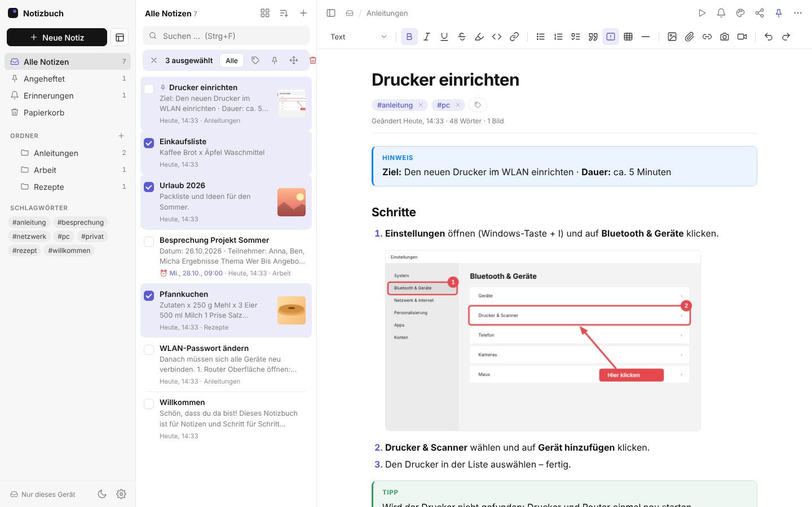
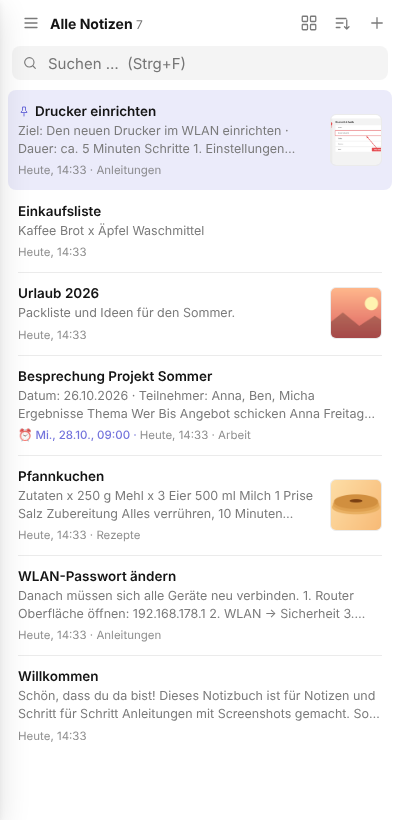
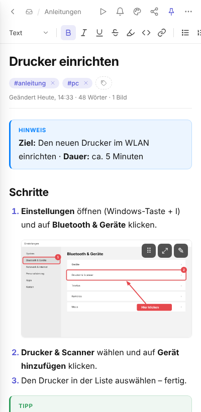

# Notizbuch

**Notizen und Schritt-für-Schritt-Anleitungen mit Screenshots** – schlicht, schnell und im Alltag zu gebrauchen.
Für Windows, mit Abgleich über Google Drive und einer Web-Version fürs Handy.

## Download

➡️ **[Neueste Version herunterladen](https://github.com/MiWi79/notizbuch/releases/latest)**

- `Notizbuch-Setup-x.y.z.exe` – Installer, aktualisiert sich danach automatisch
- `Notizbuch-Portable-x.y.z.exe` – ohne Installation, z. B. für den USB-Stick

> Windows SmartScreen meldet evtl. „Unbekannter Herausgeber“ → **Weitere Informationen → Trotzdem ausführen**.

## Funktionen

**Schreiben & Ordnen**
- Formatierter Text, Überschriften, Listen, Checklisten, Tabellen, Code, farbige Hinweis-Boxen
- Befehlsmenü mit `/`, Verknüpfungen zwischen Notizen mit `[[`, Rückverweise
- Ordner, Schlagwörter, Anheften, Volltextsuche, Schnellsuche (Strg+P)
- Vorlagen (Anleitung, Besprechung, Checkliste, Tagesnotiz, Störung – oder eigene)
- Mehrfachauswahl: mehrere Notizen gleichzeitig verschieben, verschlagworten, löschen

**Bilder & Screenshots**
- Einfügen per Strg+V, Drag & Drop (auch mehrere), Bildschirmausschnitt mit Strg+Shift+S
- Größe per Ziehen, Position, Text umfließen, Galerien, Großansicht
- Bildeditor: Pfeile, Rahmen, Text, nummerierte Schritte, Textmarker, Verpixeln, Zuschneiden, Drehen
- Text aus Bildern erkennen (OCR, offline), Bildschirmvideos, Dateianhänge

**Alltag**
- Läuft im Hintergrund: Strg+Alt+N neue Notiz, Strg+Alt+S Screenshot – überall in Windows
- Erinnerungen mit Windows-Benachrichtigung
- Präsentationsmodus (F5) – Anleitungen Schritt für Schritt im Vollbild
- Teilen per E-Mail, PDF, HTML, formatiert kopieren
- Hintergründe: liniert, kariert, Notizblock, Farben, eigenes Bild · Hell- & Dunkelmodus, Akzentfarben

**Sicherheit**
- Notizen sind normale Markdown-Dateien in deinem Ordner (z. B. Google Drive) – keine Cloud des Herstellers
- Verlauf mit älteren Versionen, Papierkorb (30 Tage), Passwort-Sperre (AES-256) für einzelne Notizen

## Ansichten

| Kachelansicht (dunkel) | Hintergründe |
|---|---|
|  |  |

| Rechtsklick-Menüs | Präsentation |
|---|---|
|  |  |

| Mehrfachauswahl | Handy |
|---|---|
|  |   |

## Datenschutz

Dieses Repository enthält nur die Programmdateien. Deine Notizen bleiben auf deinem PC bzw. in deinem eigenen Google Drive.
